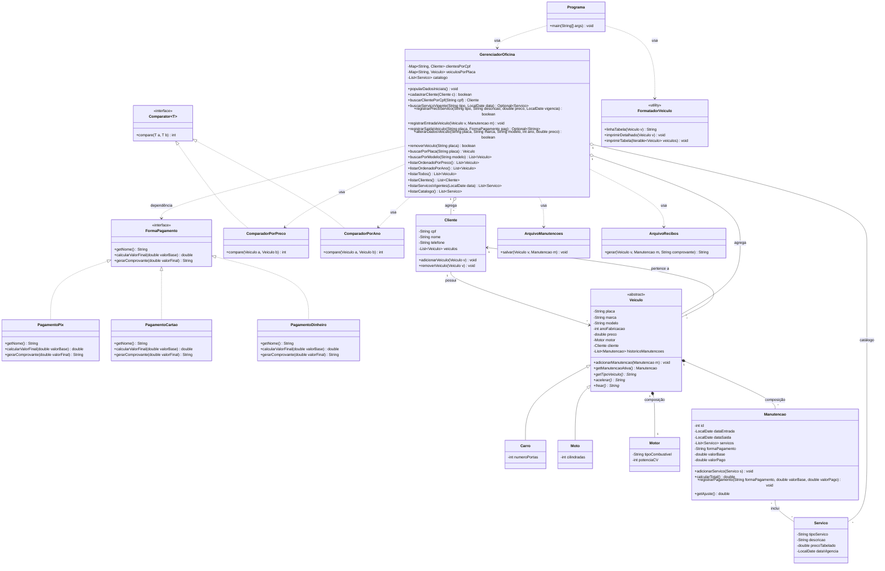

# AutoTech

Sistema de linha de comando para gerenciamento de uma oficina mecânica. Permite cadastrar clientes, registrar a entrada de veículos (carros e motos) com suas manutenções, calcular o valor de saída com diferentes formas de pagamento, buscar, alterar, remover e ordenar veículos.

O projeto foi modelado a partir de um diagrama de classes UML (PlantUML) e implementado em Java, organizado em camadas. O diagrama atual está em [`docs/diagrama-classes.md`](docs/diagrama-classes.md).

## Requisitos

- Java 21 ou superior (JDK, para compilar)
- Não há dependências externas

## Estrutura do projeto

```
AutoTech/
├── README.md
├── docs/
│   └── diagrama-classes.md   # Diagrama de classes em Mermaid
└── src/
    └── autotech/
        ├── entidades/        # Modelo de domínio (sem I/O)
        │   ├── Cliente.java
        │   ├── Motor.java
        │   ├── Servico.java          # Item do catálogo, com preço tabelado
        │   ├── Manutencao.java
        │   ├── Veiculo.java          # Classe abstrata base dos veículos
        │   ├── Carro.java
        │   └── Moto.java
        ├── negocio/          # Regras de negócio e casos de uso
        │   ├── GerenciadorOficina.java
        │   ├── FormaPagamento.java   # Interface (estratégia de pagamento)
        │   ├── PagamentoPix.java
        │   ├── PagamentoCartao.java
        │   ├── PagamentoDinheiro.java
        │   ├── ComparadorPorPreco.java
        │   └── ComparadorPorAno.java
        ├── persistencia/     # Gravação em arquivos
        │   ├── ArquivoManutencoes.java
        │   └── ArquivoRecibos.java
        └── visao/            # Interface de console
            ├── Programa.java         # Ponto de entrada (menu interativo)
            └── FormatadorVeiculo.java
```

Dependências entre camadas: `visao` → `negocio` → `persistencia` → `entidades`. As entidades não dependem de nenhuma outra camada.

## Como compilar e executar

Na raiz do projeto:

```bash
javac -d out $(find src -name '*.java')
java -cp out autotech.visao.Programa
```

Ao iniciar, o sistema carrega automaticamente **14 veículos** de exemplo (7 carros e 7 motos), cada um com um cliente fictício, e o catálogo de serviços inicial.

## Uso

O programa exibe o seguinte menu:

| Opção | Funcionalidade |
|-------|----------------|
| 1 | Cadastrar novo cliente (CPF, nome, telefone). CPFs duplicados são recusados. |
| 2 | Incluir veículo e manutenção. Se a placa já existir, o veículo existente é usado e apenas uma nova manutenção é registrada. O dono do veículo é escolhido por número, a partir da lista de clientes cadastrados (é preciso cadastrar o cliente antes, pela opção 1). Os serviços são escolhidos por número, a partir da lista de serviços vigentes. |
| 3 | Alterar dados do veículo (marca, modelo, ano e preço), identificado pela placa. |
| 4 | Excluir veículo, identificado pela placa. |
| 5 | Realizar saída e pagamento: calcula o total da manutenção em aberto, aplica a forma de pagamento, exibe a nota de serviço na tela e a grava em arquivo. |
| 6 | Buscar veículo por placa ou por modelo (busca parcial, sem diferenciar maiúsculas de minúsculas). |
| 7 | Listar veículos em tabela, ou listar ordenados por preço ou por ano. |
| 8 | Catálogo de serviços: listar os preços vigentes ou registrar um novo preço com data de vigência. |
| 0 | Sair. |

### Fluxo típico

1. **Entrada:** opção `2` com a placa do veículo. O sistema lista os serviços vigentes com preço e descrição; escolha os números desejados, um por vez, e digite `0` para encerrar. A manutenção precisa de pelo menos um serviço.
2. **Saída:** opção `5` com a placa e a forma de pagamento. O sistema marca a data de saída, registra o pagamento na manutenção, mostra a nota na tela e grava o arquivo `nota_<número>_<placa>.txt`.

## Regras de negócio

### Catálogo de serviços (preços tabelados)

Os serviços só podem ser lançados se existirem no catálogo. Cada preço tem uma data de vigência:

- Ao registrar uma manutenção, o preço usado é o da entrada vigente na data de hoje: a de maior vigência não posterior à data.
- Alterar um preço (opção `8`) cria uma nova entrada com nova vigência. As manutenções antigas mantêm o preço que estava vigente na época.
- Não é possível registrar dois preços para o mesmo serviço com a mesma vigência.

Preços iniciais (vigência `2026-01-01`):

| Tipo de serviço | Preço (R$) |
|-----------------|-----------:|
| Troca de óleo | 150,00 |
| Revisão | 350,00 |
| Freio | 280,00 |
| Alinhamento | 120,00 |
| Troca de pneus | 400,00 |

O total de uma manutenção é a soma dos preços tabelados dos seus serviços.

### Formas de pagamento

| Forma | Ajuste sobre o total |
|-------|----------------------|
| PIX | 5% de desconto |
| Cartão | 3% de acréscimo |
| Dinheiro | 10% de desconto |

Na saída, a manutenção guarda o valor base, a forma de pagamento, o desconto ou os juros aplicados e o valor pago. A busca por placa (opção 6) mostra esse histórico e o total gasto em manutenções concluídas.

## Arquivos gerados

Os arquivos são criados no diretório de execução:

- **`manutencoes.txt`**: uma linha por entrada de veículo, no formato `id;placa;dataEntrada;quantidadeServicos;total`. O arquivo é acumulado entre execuções. Ele registra apenas a entrada: a saída e o pagamento estão na nota.
- **`nota_<número>_<placa>.txt`**: nota de serviço emitida na saída, com número sequencial (o número da manutenção), dados do emitente, do tomador (nome, CPF e telefone), do veículo, datas, itens com preços tabelados e vigências, subtotal, desconto ou juros, total pago e forma de pagamento. A mesma nota é exibida na tela. Ela **não é nota fiscal eletrônica**: não é transmitida à prefeitura ou à SEFAZ, e o CNPJ do emitente fica como "não informado" até ser configurado.

## Diagrama de classes

Diagrama de classes UML, em Mermaid (também disponível em `docs/diagrama-classes.md`):



## Arquitetura

### Entidades (`entidades`)

- **`Veiculo`** é abstrata. `Carro` (com número de portas) e `Moto` (com cilindradas) são as especializações. Cada veículo possui um `Motor` próprio, um `Cliente` associado (que também mantém a lista de seus veículos) e o histórico de `Manutencao`.
- **`Manutencao`** referencia itens do catálogo (`Servico`) e controla as datas de entrada e saída. A manutenção "em aberta" é aquela sem data de saída. Na saída, guarda a forma de pagamento, o valor base e o valor pago.
- **`Servico`** é um item imutável do catálogo, com `precoTabelado` e `dataVigencia`.

### Negócio (`negocio`)

- **`GerenciadorOficina`** guarda clientes indexados por CPF, veículos indexados por placa e o catálogo de serviços. Concentra as operações de cadastro, catálogo, entrada, saída, busca, alteração, remoção e ordenação. É o único ponto que a visão chama.
- **`FormaPagamento`** é a estratégia de cálculo do valor final e de geração de comprovante. As três implementações são intercambiáveis.
- **`ComparadorPorPreco`** e **`ComparadorPorAno`** são usados para ordenação. A ordenação devolve uma cópia, sem alterar a ordem interna.

### Persistência (`persistencia`)

- **`ArquivoManutencoes`** grava o histórico de manutenções em `manutencoes.txt`.
- **`ArquivoRecibos`** gera a nota de serviço da saída em arquivo de texto.

Erros de escrita são lançados como `UncheckedIOException` e tratados pela visão, que os exibe ao usuário.

### Visão (`visao`)

- **`Programa`** contém o menu e a leitura da entrada. Não contém regras de negócio.
- **`FormatadorVeiculo`** monta as linhas de tabela e a exibição detalhada dos veículos.

## Observações

- O projeto não possui testes automatizados.
- Não há persistência dos clientes, veículos, catálogo e histórico (incluindo pagamentos) entre execuções: a carga inicial é recriada a cada início. Em arquivo, ficam apenas o registro de entradas (`manutencoes.txt`) e as notas de saída.
- Não há validação de formato para placa, CPF ou telefone.
