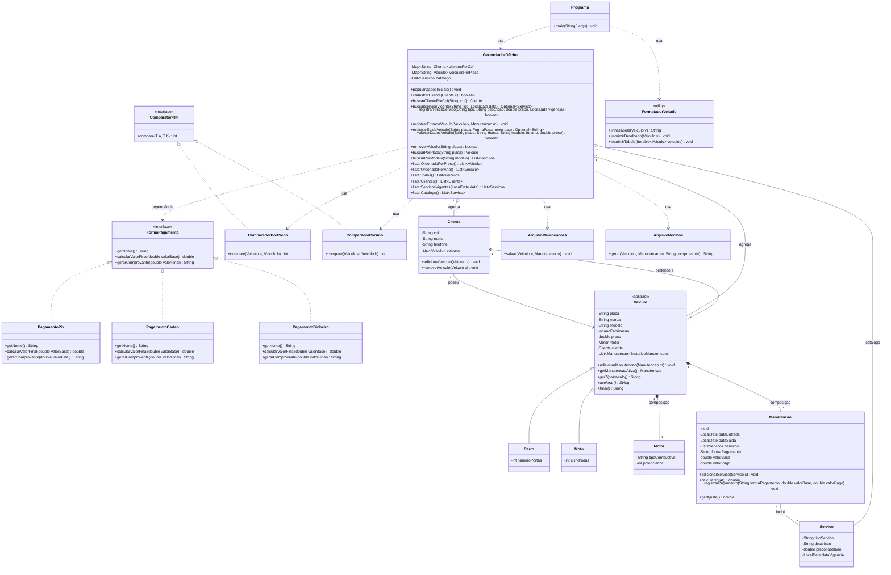

# Diagrama de classes — AutoTech

Modelo atual do sistema, organizado em camadas (`entidades`, `negocio`, `persistencia`, `visao`).

## Notas

- `GerenciadorOficina` indexa clientes por CPF e veículos por placa (chave normalizada: sem espaços, em maiúsculas). O catálogo é uma lista de versões de `Servico`: alterar um preço cria uma nova entrada com nova `dataVigencia`, e a entrada vigente em uma data é a de maior vigência não posterior a essa data.
- `Manutencao` referencia itens do catálogo (associação, não composição): um mesmo `Servico` pode estar em várias manutenções. Por isso `Servico` é imutável.
- A relação `Cliente`–`Veiculo` é mantida nos dois sentidos pelo gerenciador, ao registrar a entrada de um veículo novo e ao removê-lo.
- Na saída, `registrarSaidaVeiculo` registra na manutenção a forma de pagamento, o valor base e o valor pago. `getAjuste()` é o desconto (negativo) ou os juros/acréscimo (positivo).
- O diagrama mostra apenas os membros relevantes; os getters e setters foram omitidos.
